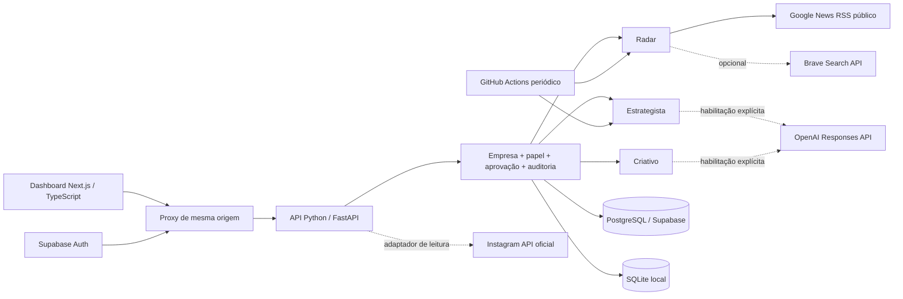

# Arquitetura e limites do MVP

Os agentes são módulos independentes executados sob demanda, com registro de execução próprio. Não são processos de IA permanentemente ligados. O índice parcial `uq_running_agent` impede duas execuções simultâneas do mesmo agente na mesma empresa. Execuções interrompidas são marcadas como falhas após 15 minutos no próximo disparo. O agendador respeita o intervalo por empresa; tentativas que falharam também contam para o intervalo, evitando repetição contínua de falhas.

## Persistência e isolamento

`workspaces` contém identidade, temas e voz da marca; `memberships` vincula usuários a `owner`, `editor` ou `viewer`. Os outros registros possuem `workspace_id`: evidências, execuções, recomendações, conteúdos, configurações, clientes, pedidos, métricas e auditoria.

No backend, cada operação verifica a identidade pelo endpoint oficial de usuário do Supabase e valida a associação à empresa antes de acessar dados. IDs de conteúdo, cliente e evidência são resolvidos dentro da empresa autorizada. A conexão PostgreSQL permanece privada no servidor. A migração ativa RLS e dá ao papel `authenticated` apenas leitura da própria empresa; o navegador não recebe permissão de escrever diretamente nas tabelas. A conta de banco do backend precisa de permissão de escrita, e não pode ser entregue ao navegador. O MVP não implementa cadastro público de empresas, planos ou cobrança de assinatura.

No modo local, SQLite permite desenvolvimento sem conta de serviço. API e dashboard devem escutar apenas em loopback; ambos validam Host, e as mutações do dashboard validam Origin. Este modo não deve ser publicado. Produção exige PostgreSQL, Supabase Auth, `APP_MODE=production`, `NEXT_PUBLIC_AUTH_MODE=supabase` e `APP_ORIGIN` HTTPS. Não há fallback silencioso para SQLite ou autenticação local em produção.

## Evidências e decisões

O Radar consulta seis feeds públicos de pesquisa e guarda título, URL, resumo curto, veículo, tema, data de publicação quando disponível e data de coleta. Não segue os links dos resultados, não extrai seguidores e não lê perfis privados. URLs enviadas manualmente são armazenadas sem requisição de rede. O conector Brave é opcional, desativado por padrão e limitado a duas pesquisas de dez resultados. Perfis encontrados são candidatos para análise humana, não parceiros ou contas comerciais comprovadas.

A afinidade é uma heurística de palavras relacionadas aos temas e à intenção comercial. Não representa probabilidade de venda, tendência estatística nem qualidade comprovada da fonte. O Estrategista usa até 40 evidências recentes; sem OpenAI, produz até cinco hipóteses explicadas por regras. Com OpenAI habilitada, exige JSON estruturado e rejeita IDs de evidência inexistentes. Evidências externas são tratadas como dados não confiáveis no prompt.

O Criativo produz rascunhos em seis formatos. Sem OpenAI, usa modelos editoriais limitados, explicitamente identificados: o conto local é uma composição fixa e não promete adaptar qualquer brief. A geração aberta depende da API configurada. A revisão automática de contos verifica 50–85 palavras, mas não substitui análise humana de qualidade, originalidade e adequação.

## Aprovações e efeitos externos

Nível 1: pesquisa, classificação e análise. Nível 2: briefs, rascunhos e calendário. Nível 3: aprovação do responsável para conteúdos e registros financeiros. Os papéis e estados são validados no servidor.

`draft → approved → planned` é um fluxo interno. `planned` não significa publicado nem agendado na Meta. Cada alteração do texto invalida aprovação e planejamento. O versionamento otimista bloqueia atualizações concorrentes. A auditoria registra aprovador, alvo, versão e horário. Somente o responsável pode aprovar textos, registrar valores, alterar estágio de pedidos ou excluir clientes. Marcar um pedido como pago apenas registra uma confirmação humana; não cobra o cliente.

Não há endpoints de follow/unfollow, envio comercial de mensagens, publicação externa ou alteração financeira em serviços terceiros. O agendador nunca chama o Criativo nem publica conteúdos.

## Evolução para SaaS

Os limites iniciais são intencionais: listas retornam os últimos 100 registros (até 500 evidências por consulta/exportação), sem paginação completa; execuções manuais ocupam uma requisição; a Meta tem vínculo de uma conta via configuração do servidor; os relatórios de métricas comparam somente duas coletas consecutivas. Antes de comercializar: adicionar fila persistente, paginação, testes de carga, rate limit distribuído, orçamento de IA por empresa, gestão de consentimento/retenção, OAuth e cofre de tokens por conta, observabilidade e recuperação de backups. Cobrança, onboarding público e multi-conta via UI permanecem pendentes.
